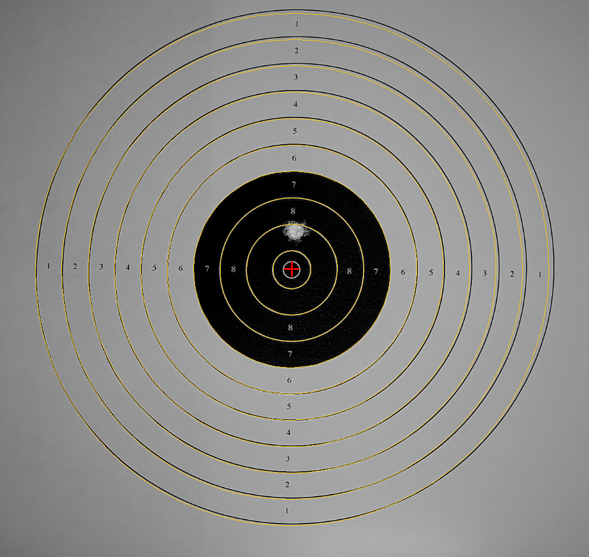

# spotter

*A spotter tells you where your shot landed.*

An electronic scoring target for **10m air pistol and air rifle training**,
built from a webcam and an ordinary paper card. No custom electronics.

You shoot. A second later you hear the score ("shot 4. 9.3, shot a touch
low") and see it on a range screen in your browser. Afterwards you review
every shot, record your own call, and track your progress toward a match
score over weeks.



## What's in it

The repo has two halves:

| | |
|---|---|
| [`engine/`](engine/) | **Python + OpenCV.** Watches the camera and listens on a microphone, locates the card, finds each new pellet hole and scores it to ISSF decimal precision. Also a standalone CLI. |
| [`web/`](web/) | **Rails 8.1.** The app you use: setup wizard, live range screen, announcer, shot review, journal, reports. It starts and stops the engine. See [web/README.md](web/README.md). |
| [`docs/engine-events.md`](docs/engine-events.md) | The contract between the two: every event the engine posts to the app. |
| [`pi/`](pi/README.md) | Optional: a Raspberry Pi at the target that only streams the camera over Wi-Fi. |

```
 camera ──USB or Pi stream──▶ engine (Python) ──HTTP events──▶ web app (Rails) ──Turbo──▶ browser
 mic ───────────────────────▶   finds + scores shots            stores, announces          range screen,
                                                                                            sound, review
```

## Quick start

You need macOS (the rig is developed there) with Homebrew, Python 3.15,
Ruby 4.0.9 (rbenv; `web/.ruby-version`) and Chrome for the browser specs.

```bash
# engine
cd engine
/opt/homebrew/bin/python3.15 -m venv .venv
./.venv/bin/python -m pip install -r requirements.txt
./.venv/bin/python selftest.py          # synthetic check, no camera: must pass

# web app
cd ../web
bundle install && bin/rails db:prepare
bin/dev                                 # http://localhost:3000
```

Sign up (a username and a 4-8 digit PIN) and press **New session**.

**No camera or gun handy?** With `bin/dev` running,
`bin/rails spotter:demo` replays a real ten-shot card through the real engine.
Sign in as `demo` / PIN `1010` and watch the range screen fill up. The card's
frames are in the repo (`engine/out/shots/demo`).

Start `bin/dev` from a terminal (or VS Code) that has macOS **camera and
microphone** permission (System Settings > Privacy & Security); the engine
inherits it. After granting it, fully restart that app.

## Using it

### A session

**New session** walks through a setup wizard every time, so the rig is known
good before the first shot:

1. **Camera:** a preview picture from every camera found (pick by what it sees)
   or a stream URL, and the target (pistol or rifle).
2. **Camera check:** live, about once a second. Fitted rings drawn on the
   picture, a sharpness number for focusing, and plain-words verdicts (focus,
   ring fit, framing, flatness, light). Next unlocks at "Ready to shoot".
3. **Sound check:** a live level meter. Fire or tap the trap; each sound is
   marked when it would trigger a shot. Or choose camera only. A mic that passed
   before is remembered.
4. **Start:** **Practice, Match or Final**, shots per card, gun and pellets.

The **range screen** then shows the whole card (zoomed as far as your shots
allow), the latest shot with its direction, this card's shots, the live camera
picture with rings drawn on, statistics and the shot list. It updates live as
you shoot. **Stop** makes a last check for an unscored hole and ends the
session. **Re-find target** recovers after a bumped camera.

In a **match** (60 shots in 75 min after 15 min sighting) or a **final**
(classic 24-shot or the newer ranking format), a virtual range officer calls
every command, the screen shows the clock and the event score, and shots out of
time score zero.

### The announcer

The browser speaks each result in one of 19 natural
[Kokoro](https://github.com/thewh1teagle/kokoro-onnx) voices, picked in
Settings. Every phrase is pre-rendered and in git, so it works with no setup.

- **Diagnostic mode** off (default): shot number, score and direction. On: also
  line calls, overlaps, shots found without a sound.
- **Chatty mode:** commentary on streaks, bests and patterns, a summary every
  ten shots and after a match.

### After shooting

- **Review and call every shot.** Each shot has straightened close-ups; you
  record the ring (and decimal) *you* see and drag a circle to where the pellet
  went. The system's proposal and your call are stored apart. The call wins
  on every score shown, and the difference between the two is the training
  data for a learned scorer.
- **Plot a missed shot by hand.** If a shot was captured but not scored, tap
  the hole on its picture, even mid-session without leaving the range screen.
- **Delete** a shot (everything after it renumbers) or a whole session.
  **Continue** a practice session from today after a break.
- **Journal** (`/journal`): score per 60 shots against a goal (default 565, the
  air pistol trials benchmark), 10-shot series, trend and forecast, personal
  bests, filtered by gun, pellets, exercise or period.
- **Gear and diary:** guns, pellets per lot, what you changed on the gun that
  day, exercises, problems, fixes and lessons per session.
- **Reports:** session and journal reports, ready to save as PDF from the
  browser's print dialog.
- **Shotmetrix export:** a session as a
  [Shotmetrix](https://github.com/shotmetrix/Shotmetrix-QRCode) QR code.

## The rig

- **Camera:** any webcam with a sharp 1080p picture (developed on a Razer Kiyo).
  It can sit **off to the side**, out of the line of fire (tested to 45 deg):
  perspective and lens distortion are solved from the printed rings in every
  frame.
- **Or stream it:** a Raspberry Pi 3 at the target streams the camera over Wi-Fi
  (`http://spotter.local:8080/stream`), and the computer at the firing line
  runs everything else. See [pi/README.md](pi/README.md).
- **Microphone (optional):** says *when* to look, never where. A mic at the
  firing line hears the gun. Without one, the camera finds each shot by itself
  in about 2 seconds, so shots fired less than ~5 s apart can be missed.
- **The card** mounted **flat** and rigid. Off-axis, a bump of height h shifts
  by about h x tan(view angle). Card centred, filling 85-95% of the frame.
- **Light:** even, without glare. A sheet of paper 1-2 cm behind the card, lit
  from the side, makes every hole show bright, including holes in the black.

## How it works

1. **Find the target from the target.** The black aiming mark is a filled disc
   of precisely known diameter; an ellipse fitted to its edge gives a first
   centre and scale. That alone is not enough when the camera sits off to the
   side: a circle seen in perspective is still an ellipse, but its centre is
   not the ellipse's centre (at 37 deg that put the 10-ring ~1.8 mm off). So
   every printed ring line is then fitted too, solving a full perspective
   transform plus two lens-distortion terms, in every frame.
2. **Find the hole.** Each shot is compared with a frame taken before it,
   registered through the target's own geometry, so only new light counts.
   A sound trigger says *when* to look; the camera also checks on its own
   every second, so a shot that made no sound is still found.
3. **Score it.** Convert to target millimetres through that model, then apply
   ISSF ring geometry (decimal scoring; the edge nearest the centre counts).

The first step is the important one. There is no fixed pixel-to-mm
calibration: because the geometry is re-derived from the card each frame,
camera drift simply cancels. The hole is measured relative to the target,
never to the sensor. Measured drift of 0.53 mm over 37 minutes has no effect
on the score.

### Why a camera

The usual DIY approach ([freETarget](https://github.com/ten-point-nine/freETarget)
and similar) triangulates the shot acoustically from four microphones. That
works very well, but it needs a custom board: microphone preamps, comparators
with a programmable threshold, and hardware counters timing to 100 ns. A camera
needs none of that. The catch is that precision moves from the time domain to
the geometry, which is where all the interesting work is.

## Measured performance

| | result | budget |
|---|---|---|
| geometry, synthetic cards 0-45 deg off-axis, exact truth | worst **0.018 mm** | 0.2 mm |
| the same test, aiming-mark ellipse only (the old model) | 1.6-6.3 mm | 0.2 mm |
| geometry noise, real camera ~37 deg off-axis (`bench`) | **0.003 mm** | 0.2 mm |
| hole detector, synthetic holes at known positions | 0.0008 mm | |
| ring fit residual, real cards | 0.08-0.20 mm RMS | |
| ring matches the shooter's call, real shots (unseen card) | 9 of 10 | |

The 0.2 mm budget is what air pistol decimal scoring needs (one decimal is
0.8 mm of radius). Geometry noise is far inside it.

What limits accuracy on real cards is the **paper**, not the camera:

- **Torn holes.** Pellets tear paper targets into holes 7-13 mm long, and the
  pellet's own mark is then a judgement call. On a 10-shot card not used for
  tuning, 9 rings matched the shooter's call and the miss was flagged. Shots
  within ~0.5 mm of a line are flagged as line calls for the shooter to decide.
- **Card flatness.** Off-axis, real cards show up to ~0.4 mm of bow; mount the
  card flat.
- **Overlapping shots.** A known-diameter circle is fitted to the round part
  of the hole's edge (2 mm separation: 0.61 -> 0.04 mm error in synthetic
  tests). Not yet proven on real overlapping holes.
- **Decimal accuracy on real shots is not yet verified** against a physical
  measurement (e.g. calipers). Whole rings are checked against the shooter's
  calls; decimals are repeatable but unconfirmed.

## The engine on its own

The engine is a CLI too, useful for aiming the rig and for working on the
vision code. From `engine/`:

```bash
./.venv/bin/python phase1.py live              # real-time HUD for aiming the camera
./.venv/bin/python phase1.py locate            # derived geometry + ring overlay
./.venv/bin/python phase1.py shot --expect 1   # before/after: score the new shot
./.venv/bin/python phase1.py shot --auto       # hands-free, sound + camera triggered
./.venv/bin/python phase1.py listen            # what the microphone hears
./.venv/bin/python phase1.py bench --label light-on   # measure the rig, A/B a change
./.venv/bin/python cameras.py                  # list cameras and their indices
```

`--target rifle` switches to air rifle. `--device` takes a camera index or a
stream URL. `--image <path>` works from a saved picture instead of the camera.

`locate` prints what it derived from the card:

```
  10m Air Pistol
  aiming mark : ring 7 = 59.5 mm
  axis ratio  : 0.8762  -> view ~29 deg off-axis
  model       : perspective + lens, from 10 rings
  ring fit    : 3483 points, RMS 0.076 mm (105 rejected)
  lens        : k1 -0.082  k2 -0.007
  perspective : scale varies 15.0% across the aiming mark
                true center is 6.3 px from the ellipse center
  scale       : 0.19900 mm/px at the center (5.0 px/mm)
```

## Development

```bash
cd engine && ./.venv/bin/python selftest.py   # detector + off-axis geometry, synthetic, no camera
cd engine && ./.venv/bin/python scoring.py    # ring tables and scoring boundaries
cd web && bundle exec rspec                   # models, requests, system specs (needs Chrome)
cd web && bin/rubocop
```

`selftest.py` establishes that the algorithm is never the limiting factor, so
any worse result on real frames comes from optics, lighting or rig stability.

- **Web app:** Rails 8.1, SQLite (a range device, no database server),
  Hotwire, Tailwind v4, ViewComponent, RSpec. Structure and settings
  (`SPOTTER_CAMERA`, `SPOTTER_MIC`, ...) in [web/README.md](web/README.md).
- **The announcer's voices:** rendering *new* lines (reworded announcements,
  chatty mode in voices not yet exported) needs Kokoro, which has its own
  Python 3.13 environment and a ~350 MB model:
  `brew install python@3.13 && engine/voice/setup.sh`.
- **Engine and app change together** through
  [docs/engine-events.md](docs/engine-events.md). The ring maths exists in
  three places (`engine/scoring.py`, `web/app/models/target_spec.rb`,
  `shot_call_controller.js`), and specs pin the same values.
- [CLAUDE.md](CLAUDE.md) has the architecture, domain facts and the gotchas
  worth knowing before changing any of it.

## Status

Working end to end on a real rig: scoring, hands-free shot detection, the web
app with practice / match / final, the announcer, review, journal, reports and
exports.

Not yet built: CSV export, announcer personalities, the microphone trigger on
the Pi, and the learned scorer trained from reviewed calls.

## Licence

[PolyForm Noncommercial 1.0.0](LICENSE): free to use, change and share for
any **noncommercial** purpose - personal training, hobby projects and research,
and use by charities, schools and the other noncommercial organisations the
licence lists. **Commercial use is not permitted**, including selling it,
building it into a product, or offering it as a paid service. For a commercial licence, get in touch through
[GitHub](https://github.com/mikedao/spotter).

The Shotmetrix QR encoder (`web/app/models/shotmetrix_code.rb`) is a port of
[Shotmetrix's reference encoder](https://github.com/shotmetrix/Shotmetrix-QRCode),
used under the Apache License 2.0; its test vectors and a copy of that licence are in
[`web/spec/fixtures/files/shotmetrix/`](web/spec/fixtures/files/shotmetrix/).
